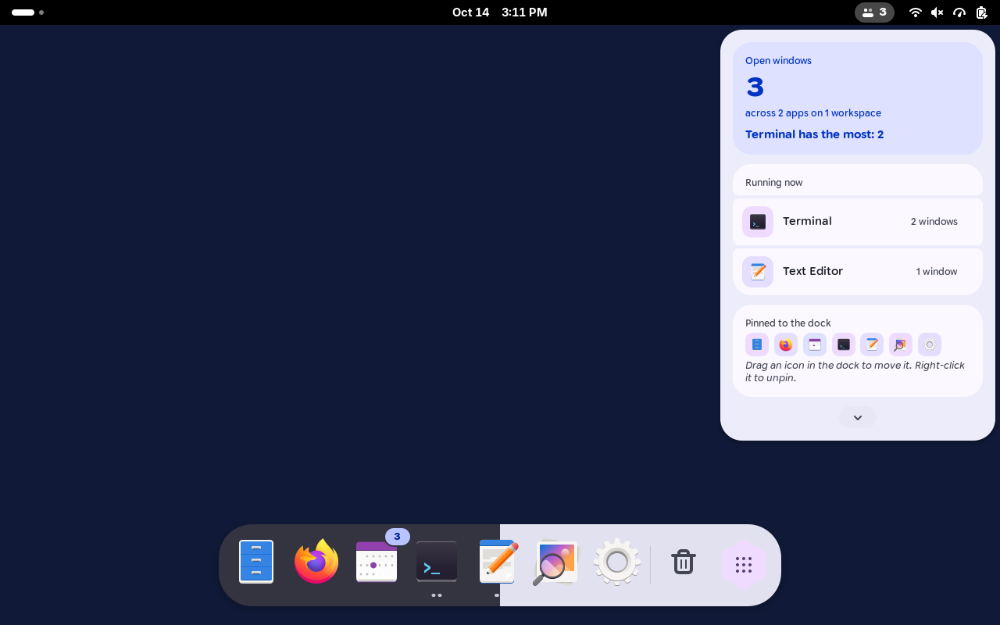
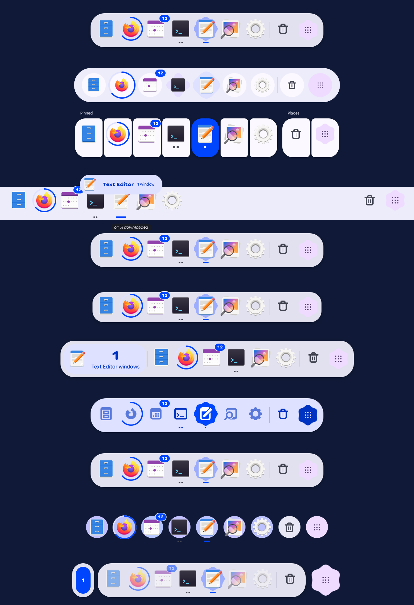
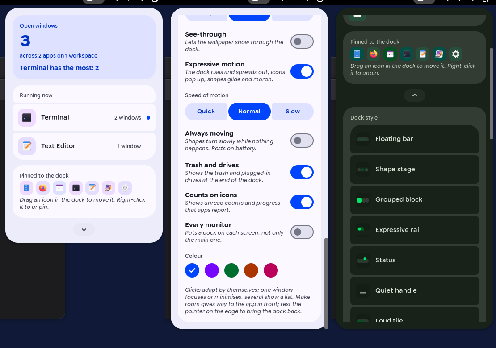
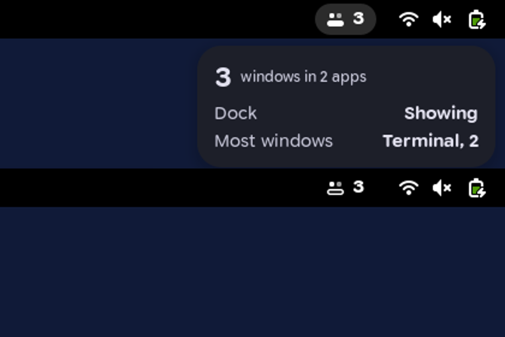
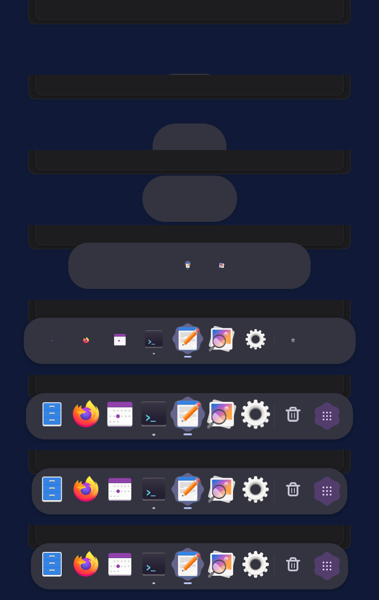
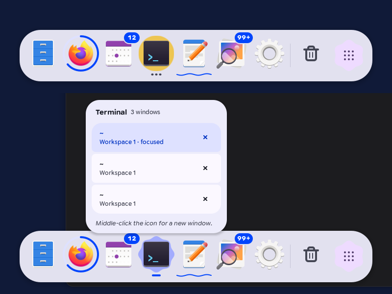
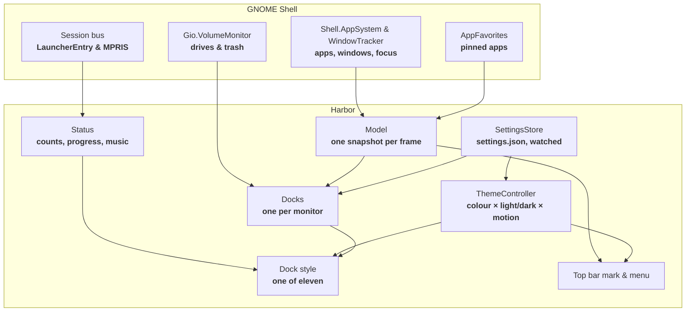

<div align="center">
  <h1>Harbor</h1>
  <p><strong>A dock for GNOME Shell in Toms Expressive Design: pinned and running apps in eleven styles, with its settings in the top bar instead of a window.</strong></p>

  <p>
    
    
    
    
    
    
    
  </p>
</div>

---



**Harbor** is a whole dock on its own. It needs nothing from **Dash to Dock** or any other extension, only **GNOME Shell 50**, so Dash to Dock can be switched off once Harbor runs.

It decides most things by itself: what a click does, when it gets out of the way, and how large its icons can be on your screen. What is left to choose sits in the top bar menu, behind a chevron. Each choice takes effect at once.

Harbor sends no notifications, reads nothing from the network and keeps one small settings file.

---

## Features

- **Eleven Styles:** From a floating bar to pebbles, an edge-to-edge rail or a split by workspace (see [The Styles](#the-styles)).
- **Pinned and Running:** Pinned apps first, then apps that run without being pinned, then drives, the trash and **Show apps**.
- **Free Icons:** The apps' own icons stand large and free. A shape behind an icon only shows a state: the pointer on it, the app starting, the app waiting. A shape in the focused app's tone glides from app to app.
- **Expressive Motion:** The dock rises as a pill from the middle of the edge, spreads to both sides with a swing, and lets the icons pop up from the middle outwards (see [Motion](#motion)).
- **Clicks That Adapt:** One click starts, focuses or minimises; an app with several windows shows a **window list** instead of pictures of windows.
- **Making Room:** The dock steps aside when a window of the app in front comes close, and returns when the pointer rests on the edge. A thin handle can stay behind, per style.
- **Status on the Icons:** Unread counts that pop and count up, a progress ring, a wiggle and a warning colour when an app wants attention, and a small wave while an app plays music.
- **Minimise Into the Icon:** A window minimises into its app's icon in the dock.
- **Drag to Arrange:** Drag an icon along the dock to move it, out of the dock to unpin it, or from the app grid into the dock to pin it.
- **Right-Click Menu:** The app's own actions, a new window, pin or unpin, and quit, laid out like the rest of Harbor.
- **A Mark in the Top Bar:** Two app tiles on a shelf and the number of open windows. Resting the pointer on it shows a small look; a click opens the menu.
- **Every Monitor:** One dock per screen if you want it, each marking the windows on its own screen.
- **Five Colour Styles:** **Blue**, **violet**, **green**, **orange** and **pink**, each in light and dark.
- **Light, Dark and Motion:** Harbor follows GNOME's colour scheme and its animation switch while it runs.

---

## The Styles



| Style | What it looks like | What is special |
| :--- | :--- | :--- |
| **Floating bar** | A rounded bar floating above the edge | The default. A shape in the app's tone glides behind the focused app. |
| **Shape stage** | A pill; every app stands on a shape | The shape is the run indicator: a circle while closed, more points with more windows. |
| **Grouped block** | Three named groups instead of one bar | The focused app's segment turns fully round and fills with the primary colour. |
| **Expressive rail** | A rail along the whole edge | The focused app unfolds into a pill with its name. Always keeps its room unless set to **Hide**. |
| **Status** | The floating bar | Status is said out loud: "64 % downloaded", "Wants attention", even with **Counts on icons** off. |
| **Quiet handle** | A compact, calmer bar | Less padding and softer corners; made for a dock that is often away. |
| **Loud tile** | The floating bar led by a large tile | The tile shows the focused app with its window count; without one, all open windows. |
| **Mono container** | A round bar in one colour | Every icon in one colour; closed apps fade back; a primary shape glides behind the focused app. |
| **Window list** | The floating bar | An app's window list opens as soon as the pointer rests on it. |
| **Pebbles** | No bar; every app floats on its own | Pebbles near the pointer grow; the one under it turns into a cookie and shows its name. Pebbles appear one by one. |
| **Workspace split** | Three floating parts | Workspaces as buttons; apps without a window on this workspace fade back. |

Every style works at the **left**, **bottom** and **right** edge (*tested* in the headless shell, light and dark).

---

## The Menu and the Top Bar



- **Open Windows:** The one loud tile: how many windows are open, across how many apps and workspaces, and which app has the most.
- **Running Now:** Every running app with its window count; a dot marks the focused one. A click acts like a click in the dock.
- **Pinned to the Dock:** The pinned apps as small icons.
- **Settings:** Behind the chevron at the bottom, closed again whenever the menu opens.



| Mark | Meaning |
| :--- | :--- |
| **Filled shelf** | The dock shows. |
| **Outlined shelf** | A window keeps the dock away, or it is set to hide. |
| **Yellow mark and number** | An app wants attention. Nothing else is sent. |

---

## Settings

| Setting | Choices (default in bold) | What it does |
| :--- | :--- | :--- |
| **Dock style** | **Floating bar**, Shape stage, Grouped block, Expressive rail, Status, Quiet handle, Loud tile, Mono container, Window list, Pebbles, Workspace split | How the dock looks. Four styles show first; the rest unfold. |
| **Where the dock sits** | Left, **Bottom**, Right | The screen edge. |
| **Handle when away** | **On**, Off, for each style on its own | A thin grip stays at the edge while the dock is away. |
| **Show on hover** | **On**, Off | Resting on the handle brings the dock; off, it takes a click. |
| **Icon size** | Small 52, **Medium 64**, Large 76 | The size of the app icons as you see them; everything in a style scales with it. An earlier **Huge** becomes **Large**. |
| **When a window comes close** | Stay, **Make room**, Hide | **Stay** keeps the dock and its room; windows maximise up to it. **Make room** steps aside while a window of the app in front overlaps it. **Hide** stays away until you need it. |
| **See-through** | On, **Off** | The bars at **78 %**, as in **Ledge**. |
| **Expressive motion** | **On**, Off | Springs for appearing, going and every state; off, the dock slides as calmly as before. |
| **Speed of motion** | Quick, **Normal**, Slow | About **350**, **500** or **700 ms** for the dock to appear; all motion follows. |
| **Always moving** | On, **Off** | Shapes turn slowly while nothing happens. Rests on battery and while the dock is away. |
| **Trash and drives** | **On**, Off | Shows the trash and plugged-in or network drives at the end of the dock. |
| **Counts on icons** | **On**, Off | Shows unread counts, progress and attention that apps report. |
| **Every monitor** | On, **Off** | One dock on each screen instead of only the main one. |
| **Colour** | **Blue**, Violet, Green, Orange, Pink | The colour style of the dock and the menus. |

The settings live in **`~/.config/harbor/settings.json`**. A value Harbor does not know falls back to its default on its own; a broken file costs nothing but the broken values (*tested*).

One key is not in the menu: **`"debug": true`** writes every decision of the dock (showing, going and why, its place, menus) to the journal:

```bash
journalctl -f -o cat /usr/bin/gnome-shell | grep Harbor
```

---

## Motion



| Moment | What moves |
| :--- | :--- |
| **Appearing** | A pill rises from the middle of the edge, spreads to both sides past its length and back, and the icons pop up from the middle outwards. Groups of a style (**Workspace split**, **Grouped block**) follow one another. |
| **Going** | The reverse in about two thirds of the time, without swinging: the icons gather in the middle, the bar draws into a pill and sinks. |
| **A new style** | It shows itself with its own appearing, even on a dock that is away. |
| **Starting an app** | Its shape breathes between circle and cookie and the icon hops, until the window comes (at most **10 s**). |
| **A new or closed app** | Its neighbours move apart and it grows in, or it shrinks and they close up. |
| **Focus** | The focus shape glides to the next app and follows it if it moves. |
| **Hover and click** | A shape grows and morphs behind the icon, the icon lifts **4 px**; a press pushes the slot in and it springs back. |
| **Counts and attention** | A new count pops and counts up; an app that waits wiggles every **4 s** and pulses. |

The springs are Material 3 Expressive's, as in **Ledge**. GNOME's own **Animations** switch turns all of it off.

---

## What Harbor Decides by Itself

These are not settings, on purpose. If one of them is wrong for you, the fix belongs in the code.

| Situation | What happens |
| :--- | :--- |
| **Click on an app that is closed** | It starts. |
| **Click on an app that runs, but not in front** | Its last used window comes forward. |
| **Click on the focused app with one window** | The window minimises. |
| **Click on the focused app with several windows** | The window list opens. |
| **Middle click** | A new window. |
| **Mouse wheel over an app** | Goes through that app's windows. |
| **A window comes close** | With **Make room**, only the windows of the app in front count, as with Intellihide. The dock leaves and comes back when they have gone. |
| **Pointer resting on the edge** | After **200 ms** on the last pixel row under the dock, it returns; no push needed. It leaves again **0.5 s** after the pointer does. |
| **Resting on the handle** | After **150 ms** the dock returns (with **Show on hover**). |
| **Fullscreen** | The dock is gone. |
| **Overview** | Harbor stays, and GNOME's own dash steps aside. |
| **Too many apps for the edge** | The icons get smaller step by step, and grow back when there is room again. |
| **Hover delays, run indicator, Show apps size, Super + 1 to 9** | Fixed. Super + 1 to 9 stays GNOME's. |

---

## Where Status Comes From

| Status | Source |
| :--- | :--- |
| **Unread counts, progress, urgency** | The **`com.canonical.Unity.LauncherEntry`** D-Bus signal, the same one Dash to Dock reads. Apps that do not send it show nothing; Harbor does not count notifications for them. |
| **Wants attention** | The window asks for it (`demands-attention` or `urgent`), or the app reports urgency. |
| **Music playing** | An **MPRIS** player whose desktop entry belongs to the app reports **Playing**. |



---

## Installation

```bash
git clone https://github.com/tomsliikee/harbor.git
cd harbor
./install.sh
```

The script links the extension, installs **Google Sans Flex** if it is missing, enables Harbor, and offers to switch **Dash to Dock** off. GNOME Shell under Wayland loads a new extension only at the next login, so log out and back in.

```bash
./install.sh --remove
```

removes the link and disables Harbor; the settings file stays.

---

## Architecture



Colours come from **`extension/lib/palettes.js`**: each style is Material 3's **SchemeVibrant** of one seed. Structure is in **`tools/stylesheet.template.css`**, written once per colour and scheme into **`extension/stylesheet.css`** by **`gjs -m tools/build-stylesheet.js`**. Text is set through **Pango** attributes, because St cannot reach the axes of a variable font.

---

## Development

| Task | Command |
| :--- | :--- |
| **Unit tests** | `for t in tests/*.test.js; do gjs -m "$t"; done` |
| **Motion frame by frame** | `HARBOR_ONLY="floating-bar pebbles" tools/headless/run.sh motion 190` |
| **Stylesheet** | `gjs -m tools/build-stylesheet.js` |
| **Headless shell** | `tools/headless/run.sh <script> [seconds]` with a script from **`tools/headless/scripts`**; screenshots land in **`$TMPDIR/harbor-headless`** |
| **Two monitors** | `HARBOR_MONITORS=2 tools/headless/run.sh lifecycle` |
| **Beside other extensions** | `HARBOR_WITH="tally@thomashaiden=$HOME/git/tally/extension" tools/headless/run.sh lifecycle` |

---

## Status of This Version

| Area | Evidence |
| :--- | :--- |
| **Settings, shapes, springs, words, layout rules** | ***Tested:*** 48 unit tests. |
| **Appearing and going in every style, focus gliding, hover, start, attention, counts** | ***Tested*** in the headless shell, frame by frame in slow motion (`motion` script). |
| **Make room for the app in front, edge, handle per style, see-through, minimising into the icon** | ***Tested*** in the headless shell (`behave` script). |
| **All eleven styles at three edges, light and dark** | ***Tested*** in the headless shell by screenshot. |
| **Clicks, right-click menu, window list, pinning by drop, making room** | ***Tested*** in the headless shell with a virtual pointer. |
| **The edge with a real touchpad, the room kept by Stay and the rail, smoothness on real hardware, Always moving on battery** | ***Built.*** The edge was tested with a virtual pointer; the rest was not measured. |
| **Two monitors, overview, switching off and on through every style** | ***Tested*** in the headless shell, beside **Tally**, **Ember** and **Torch**, without errors. |
| **Dragging with a real mouse, the app grid as a drag source** | ***Built.*** The drop itself is tested; a real drag is not. |
| **Real LauncherEntry and MPRIS senders** | ***Built.*** Tested with states handed in by the test script. |
| **A real session after login, real second monitor** | ***Planned:*** not yet run outside the headless shell. |

---

## Decisions Made While Building

- **Colours through one stylesheet class per scheme, not only `set_style()`:** St has no CSS variables, so the stylesheet is written once per colour and scheme and a colour change swaps one class. Hover and focus states keep working this way. Values that scale or animate are set in code.
- **Free icons, shapes only for states:** An icon on a permanent tile looked cramped. Each app keeps a tone (**primary**, **secondary** or **tertiary container**, chosen from its app id), but it only shows behind the icon on hover, at a start, and as the focus shape.
- **Bars painted behind the buttons:** A bar is drawn by a stand-in on a layer below the icons, so it can spread from a pill and a focus shape can glide between it and the icons.
- **Resting on the edge instead of a push:** A push of 100 px was hard on a touchpad; 200 ms on the last row is as hard to set off by passing by.
- **Make room for the app in front only:** Every window on the workspace kept the dock away almost always.
- **A list of styles in the menu:** Eleven styles do not fit segmented buttons; four rows show first, the chosen one always among them.
- **No notification when pinning:** Pinning from the dock uses the shell's quiet calls; the change is in front of you anyway.
- **The empty last workspace is hidden** in **Workspace split**, unless it is the active one.
- **Show apps is a pebble too** in **Pebbles**, as are the drives and the trash.
- **The icons shrink by themselves** when the dock would not fit its edge, the way Dash to Dock does it; it is not a setting.
- **A side dock leaves out long text:** the loud tile shows only its number, and the group names of **Grouped block** are hidden at the left and right edge.
- **Pills that reach beyond the dock** (status sentences, the rail's pill, pebble names) live on a layer that asks for no room, so the dock keeps its own size.

---

## License

MIT, see **[LICENSE](LICENSE)**. Google Sans Flex is under the SIL Open Font License, see **`toms-expressive-design/fonts/OFL.txt`**.
